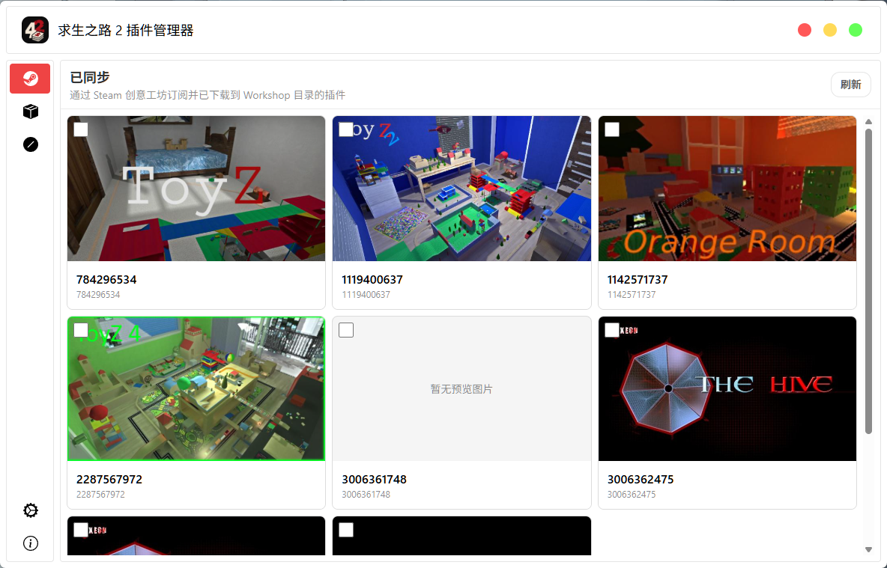
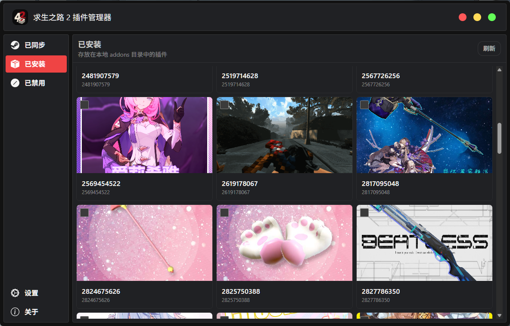

# l4d2am

<p align="center">
  
</p>

`l4d2am` 是《求生之路 2》的 Workshop 插件管理器。它按插件的 Workshop item ID 管理游戏目录中的 VPK 文件及对应预览图，帮助整理已订阅、已转为本地和已禁用的插件。

## 界面预览

### 已同步



### 已安装



## 功能

- **已同步**：查看仍订阅并位于 Steam Workshop 目录中的插件
- **已安装**：查看位于本地 `addons` 目录中的插件
- **已禁用**：查看已移入对应 `.disabled` 目录的插件
- 为插件设置别名，便于识别
- 将 Workshop 插件移动到本地 addon 目录，并取消对应订阅
- 将本地 addon 目录内的插件移动回 Workshop：先订阅，再移动
- 删除已禁用插件
- 将所选插件的 VPK 和 JPG 预览图导出到 ZIP 文件

## 游戏目录

在 **设置 → 游戏目录** 中点击 **自动检测**，应用会通过 Steamworks 查询 Steam App ID `550`（Left 4 Dead 2）的安装目录，并检查相关文件夹。也可以手动选择安装目录中的 `left4dead2.exe`。

应用根据所选目录定位以下文件夹：

```text
<Left 4 Dead 2 安装目录>/left4dead2/addons/workshop/
<Left 4 Dead 2 安装目录>/left4dead2/addons/
```

Workshop 插件以 item ID 命名，例如 `123456789.vpk` 和 `123456789.jpg`。禁用时，文件会移入各自目录下的 `.disabled` 子目录。

设置保存在应用根目录的 `settings.json` 中。alias 和界面偏好保存在本地应用存储中。

在 **设置 → 别名管理** 中可以导出或导入 CSV。文件包含 `id,alias` 表头和对应的数据行；导入会合并到现有别名，同 ID 的内容以导入文件为准。清除按钮会立即移除所有别名。

## 插件操作

在已同步、已安装或已禁用页面中，点击卡片图片（没有预览图时点击占位区域）即可选择插件；右键卡片可打开操作菜单。可以使用卡片上的 alias 作为显示名称，item ID 仍会显示在卡片上。

禁用已同步插件时，应用会将 VPK 和 JPG（如存在）移动到 Workshop 的 `.disabled` 目录，并取消订阅。恢复后会移回 Workshop 目录并重新订阅。禁用本地插件只会将文件移入本地 `addons/.disabled`；恢复会将文件移回 `addons`。

删除仅针对已禁用的插件，会永久删除其中的 VPK 和配套 JPG（如存在）。转换到本地会先将 Workshop 文件移动到本地 `addons`，再取消订阅；转换回 Workshop 会先订阅，再将本地文件移回 Workshop 目录。

无论单选还是多选，所有所选插件的 VPK 和可用 JPG 都会放入同一个 ZIP。先通过保存对话框选择 ZIP 的保存位置和文件名，再开始导出。

## Steam 要求

Steamworks 必须初始化成功，应用才会启动。请先启动 Steam，并确保 Left 4 Dead 2 已安装。Steamworks 用于查询游戏安装目录和管理 Workshop 订阅。

Steamworks SDK 运行库不包含在 Git 仓库和安装包中。开发或自行打包时，需自行取得有权使用的运行库，并放在项目根目录的 `steamworks_sdk/`；打包运行时则需放在应用的 `resources/steamworks_sdk/`。若运行库缺失或 Steamworks 初始化失败，应用会显示错误并退出。

## 开发

开发环境需要 Node.js `22.12` 或更高版本，以及 pnpm `10`。

```sh
pnpm install
pnpm dev
```

常用命令：

| 命令 | 用途 |
| --- | --- |
| `pnpm typecheck` | 检查主进程和渲染进程的 TypeScript 类型 |
| `pnpm build` | 类型检查并构建应用 |
| `pnpm build:unpack` | 构建未打包应用 |
| `pnpm build:win` | 构建 Windows 安装包 |
| `pnpm build:mac` | 构建 macOS 安装包 |
| `pnpm build:linux` | 构建 Linux 安装包 |

Electron 主进程、preload 和渲染进程代码分别位于 `src/main`、`src/preload` 和 `src/renderer`。

## 许可

项目许可见 [LICENSE](LICENSE)。Steamworks SDK 文件受其自身许可条款约束。
